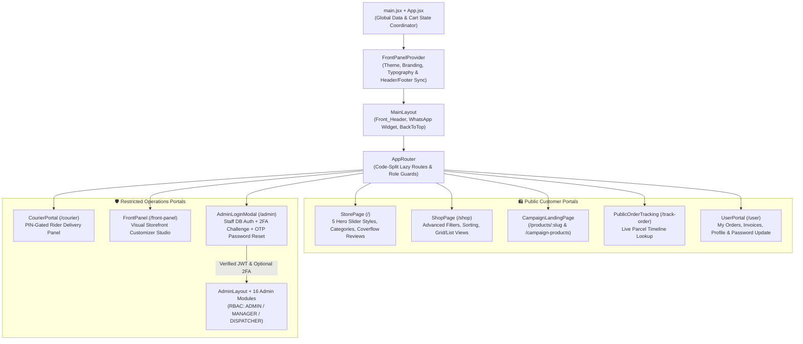
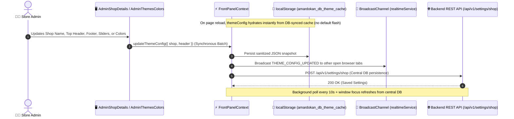

<div align="center">

# 🎨 SketchGuard — Frontend Application
### **Single Page Storefront, Campaign Funnel & Operations Command Center**

[](https://react.dev/)
[](https://vitejs.dev/)
[](https://tailwindcss.com/)
[](https://motion.dev/)
[](https://vercel.com/)

<p align="center">
  <b>High-speed React 19 Single Page Application (SPA) for the SketchGuard Bangladesh-native e-commerce platform.</b><br/>
  Built with isolated customer storefronts, conversion-optimized campaign funnels, self-service tracking portals, courier rider hub, real-time DB-backed theme synchronization, and a role-gated Operations Admin Panel with 2FA verification.
</p>

</div>

---

## 🏗️ Frontend Architecture

**SketchGuard Frontend** is structured around a central lazy-loaded router (`AppRouter`), a real-time DB-synced theme/config provider (`FrontPanelContext`), and a resilient REST client (`api.js`) that connects via Vite dev proxy locally or `VITE_API_BASE_URL` in production.

### 1. Application Routing & Multi-Portal Architecture



---

### 2. Real-Time Theme, Branding & Cross-Tab Synchronization Flow

To prevent default branding flicker on reload and ensure identical storefront state across all devices, `FrontPanelContext` synchronizes with the central backend database and caches the validated snapshot locally (`amardokan_db_theme_cache`).



---

## 🌟 Core Frontend Modules & Capabilities

- **Public Storefront (`StorePage.jsx`, `ShopPage.jsx`, `HeroSection.jsx`):**
  - 5 selectable dynamic Hero Slider styles (`AdminSliders.jsx`), product cards with variant/discount badges, interactive 360° & gallery modals (`ProductDetailModal.jsx`), and 3D customer review coverflow (`CustomerReviewsCoverflow.jsx`).
- **Conversion-Focused Landing Pages (`CampaignLandingPage.jsx`):**
  - Supports multi-product special campaigns (`/campaign-products`) and clean per-product SEO URLs (`/products/:slug`) via `campaignHelper.js`, with countdown urgency timers, sticky COD checkout, and hybrid Pixel + Meta CAPI tracking (`marketing.js`).
- **Checkout & Bangladesh Local Flows (`GuestCheckoutModal.jsx`, `CartDrawer.jsx`):**
  - 11-digit BD mobile validation (`013–019`), Dhaka/Outside Dhaka delivery fee calculator (`bangladesh.js`), coupon validation, Cash on Delivery (COD), bKash/Nagad/Rocket channels, and **SSLCommerz** online gateway redirect.
- **Customer Self-Service (`UserAuthModal.jsx`, `UserPortal.jsx`):**
  - Mobile/Email login, registration, email temp-password recovery, order history with printable VAT-ready invoices (`InvoiceModal.jsx`), and profile + password update form.
- **Admin Command Center (`AdminSidebar.jsx`, `AdminLayout.jsx`):**
  - **Role-Based Access Control (RBAC):** `ADMIN` (Full Access), `MANAGER` (Operations, Products, Orders, Campaigns, Reviews, Notifications, Recycle Bin), `DISPATCHER` (Orders & Couriers).
  - **Security Gate (`AdminLoginModal.jsx`):** Staff authentication against central DB, **Two-Step Verification (Authenticator TOTP / Email OTP / Recovery PIN)** challenge screen, and **Admin Forgot Password** (Username/Email 6-digit OTP recovery).
  - **Admin Modules:** Overview Analytics (`Graph.jsx`), Shop Details & Branding Hub, Themes & Colors Studio (`themeHelper.js`), Sliders, Media Library (Cloudinary + Media Picker), Customer Reviews, Order Management (with Filtered PDF Statement export & soft delete), Products & Bulk CSV Import, Special Campaign Products, Courier Integration Hub, Payments & SSLCommerz Gateway Hub, Marketing & CAPI, Notifications (SMTP Email Gateway), Security & Immutable Audit Logs (with **Two-Step Verification Setup Panel**), Staff & Access Control, and Recycle Bin.

---

## 💻 Frontend Tech Stack

| Technology | Version | Purpose |
|---|---|---|
| **React** | `^19.0.1` | Component-based UI & React 19 concurrent rendering |
| **Vite** | `^8.3.0` | Ultra-fast dev server, `/api` proxy, and Rollup/Rolldown bundler |
| **Tailwind CSS** | `^4.3.3` | Utility-first responsive design system (`@tailwindcss/vite`) |
| **Motion** | `^12.23.24` | Fluid UI animations, drawers, and review transitions |
| **Lucide React** | `^0.546.0` | Clean vector iconography across Storefront & Admin |
| **Custom State & Services** | Built-in | `FrontPanelContext`, `LanguageContext`, `CartContext`, `apiFetch`, `realtimeService` |

---

## 📁 Frontend Directory Structure

```text
frontend/
├── index.html                        # Root HTML template with instant DB theme title hydration
├── package.json                      # Dependencies & Vite scripts (dev, build, preview)
├── vite.config.js                    # Vite build chunks & /api -> 127.0.0.1:8000 local proxy
├── vercel.json                       # SPA rewrite rules (/(.*) -> /index.html) for Vercel
├── .env.example                      # Frontend environment template
└── src/
    ├── App.jsx                       # Root view state, URL sync, product/order/cart coordinator
    ├── main.jsx                      # React 19 entry point
    ├── Layouts/
    │   ├── MainLayout.jsx            # Storefront wrapper (Front_Header, WhatsApp, BackToTop)
    │   └── AdminLayout.jsx           # Admin shell (Sidebar, Header, tab title resolver)
    ├── routers/
    │   └── AppRouter.jsx             # Lazy-loaded routes & role-based admin tab guard
    ├── pages/
    │   └── StorePage.jsx             # Primary home storefront layout
    ├── Context/
    │   ├── LanguageContext.jsx       # Localization & category/product label helpers
    │   └── CartContext.jsx           # Shopping bag state helpers
    ├── components/
    │   ├── admin/                    # Operations Admin Portal (16 views + modals & charts)
    │   ├── frontPanel/               # FrontPanelContext, defaultThemeConfig & visual customizer
    │   ├── Header/                   # Front_Header, Product_Header, Campaign_Header, Admin_Header, Courier_Header
    │   ├── Footer/                   # Dynamic DB-driven Storefront Footer
    │   ├── hero/                     # Multi-style HeroSection slider engine
    │   ├── Landing/                  # CampaignLandingPage
    │   ├── Product/                  # ProductCard, ProductDetailModal & galleries
    │   ├── Cart/                     # Slide-over CartDrawer
    │   ├── Checkout/                 # GuestCheckoutModal & OrderConfirmationModal
    │   ├── Reviews/                  # CustomerReviewsCoverflow 3D showcase
    │   ├── shop/                     # ShopPage full catalog browser
    │   ├── Tracking/                 # PublicOrderTracking lookup
    │   ├── user/                     # UserAuthModal & UserPortal
    │   ├── courier/                  # CourierPortal rider view
    │   ├── WhatsApp/                 # Floating WhatsApp widget
    │   ├── BackToTop/                # Smooth scroll-to-top widget
    │   └── common/                   # Reusable modals
    ├── services/
    │   ├── api.js                    # Unified REST client (uses VITE_API_BASE_URL in production)
    │   ├── realtime.js               # Cross-tab BroadcastChannel + localStorage event sync
    │   ├── marketing.js              # Meta Pixel + server CAPI event deduplication
    │   ├── notifications.js          # Active shop info cache for templates
    │   └── payment.js                # Client payment helpers
    └── utils/
        ├── bangladesh.js             # BD districts, thanas, 01X phone regex, BDT formatters
        ├── campaignHelper.js         # Active campaign matching & canonical URL resolver
        ├── categories.js             # Category extraction & normalization
        ├── imageCompressor.js        # Client-side image compression before upload
        ├── paymentConfig.js          # Payment channel metadata & labels
        ├── productImage.js           # Safe image fallbacks
        ├── textSanitizer.js          # Text normalization utilities
        └── themeHelper.js            # Dynamic CSS variable injection & resolveThemeText
```

---

## ⚙️ Environment Variables & Local Setup

### 1. Environment Variables (`frontend/.env`)
Create `frontend/.env` from `frontend/.env.example`:
```env
# Leave empty in local development (Vite proxies /api and /media to http://127.0.0.1:8000)
# Set this in production (e.g. Vercel) to your live Render backend URL (without trailing slash):
VITE_API_BASE_URL=
```

### 2. Local Development
```bash
cd frontend
npm install
npm run dev
```
- **Storefront:** `http://localhost:3001/`
- **Admin Portal:** `http://localhost:3001/admin`
- **Production Build Check:** `npm run build` (outputs to `frontend/dist`)

---

## 🚀 Vercel Deployment Guide (Standalone Frontend Repo)

1. Push the `frontend/` directory to its own GitHub repository.
2. Import the repository in **Vercel**:
   - **Framework Preset:** `Vite`
   - **Build Command:** `npm run build`
   - **Output Directory:** `dist`
3. Add **Environment Variable** in Vercel:
   - `VITE_API_BASE_URL` = `https://your-sketchguard-backend.onrender.com`
4. `vercel.json` automatically handles all client-side React routes (`/admin`, `/shop`, `/products/...`, `/campaign-products`, `/track-order`, `/user`) without 404 errors on refresh.

